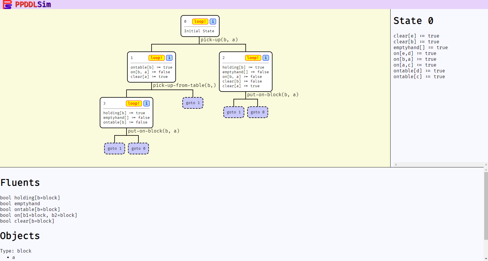
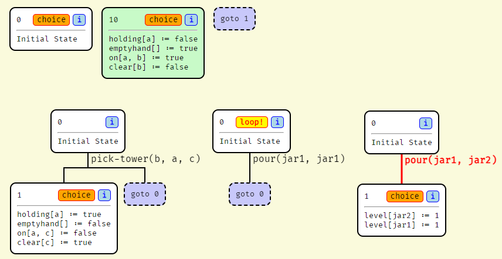

# PPDDL
In the context of automated planning, the PDDL language is often used to define
the domain of the problem. This is done with predicates that describe the
environment and actions that alter the state of said environment.

PPDDL is an extension of the PDDL language, which allows for the representation
of _probabilistic_ actions. These are actions that may have a number of
different outcomes, used to describe more realistic behaviours.

# Interactive Graphic Simulator
PDDL files can be hard to parse visually by a developer, and introducing
probabilistic actions only worsens this problem. To facilitate this, we
introduce the PPDDL Interactive Graphic Simulator.

The simulator gives a graphical interface which allows the developer to more
easily validate and explore the domain described by a file.

The simulation begins in a starting configuration described in a problem file.
The developer can then simulate different actions and see how they alter the
state. Each visited state is described by a node with a unique identifier and
the alterations in state with respect to its predecessor.

The simulator also gives warnings about infinite loops, as well as showing when
a desired goal state is reached.

